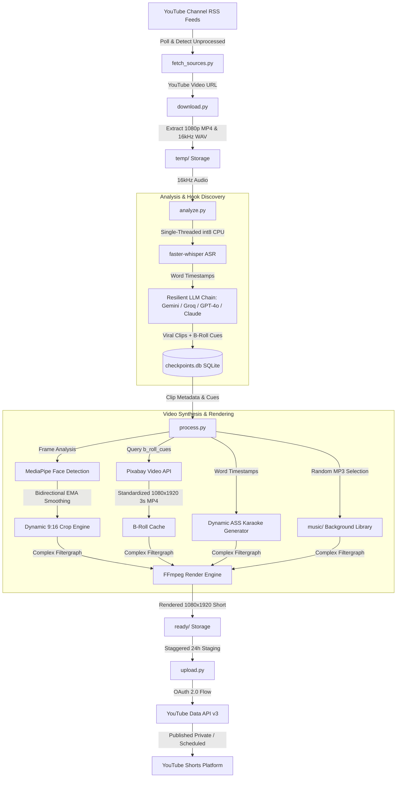

# 🎬 Autonomous YouTube Shorts Content Engine (`v2`)

[](https://www.python.org/)
[](https://github.com/SYSTRAN/faster-whisper)
[](https://developers.google.com/mediapipe)
[](https://ffmpeg.org/)
[](https://developers.google.com/youtube/v3)
[](https://opensource.org/licenses/MIT)

An enterprise-grade, fully autonomous content production and distribution pipeline engineered to ingest long-form video broadcasts (podcasts, technical interviews, keynotes), extract peak-retention narrative moments, dynamically reframe landscape video to 9:16 vertical video using real-time computer vision, overlay contextually aware stock B-roll, composite animated karaoke subtitles, duck background music, and schedule batch releases via the YouTube Data API v3.

Designed from the ground up for headless servers, budget cloud virtual machines, and local development environments without requiring dedicated GPU infrastructure.

---

## 📑 Table of Contents

- [Architectural Overview](#-architectural-overview)
- [Core Features & Engineering Highlights](#-core-features--engineering-highlights)
  - [1. Automated RSS Ingestion & State Engine](#1-automated-rss-ingestion--state-engine)
  - [2. Single-Threaded CPU Optimization for faster-whisper](#2-single-threaded-cpu-optimization-for-faster-whisper)
  - [3. MediaPipe Dynamic Face Tracking & Motion Smoothing](#3-mediapipe-dynamic-face-tracking--motion-smoothing)
  - [4. Pixabay Video API B-Roll Overlay](#4-pixabay-video-api-b-roll-overlay)
  - [5. FFmpeg Complex Filtergraphs (Audio Ducking & Karaoke Subtitles)](#5-ffmpeg-complex-filtergraphs-audio-ducking--karaoke-subtitles)
  - [6. OAuth2 Scheduled Batch Uploading](#6-oauth2-scheduled-batch-uploading)
- [Repository Structure](#-repository-structure)
- [Local Setup & Prerequisites](#-local-setup--prerequisites)
  - [Prerequisites](#prerequisites)
  - [Step 1: Clone Repository & Virtual Environment](#step-1-clone-repository--virtual-environment)
  - [Step 2: Install System Dependencies](#step-2-install-system-dependencies)
  - [Step 3: Install Python Dependencies](#step-3-install-python-dependencies)
  - [Step 4: Environment Configuration](#step-4-environment-configuration)
  - [Step 5: YouTube API Credentials](#step-5-youtube-api-credentials)
  - [Step 6: Royalty-Free Music Library](#step-6-royalty-free-music-library)
- [Usage Guide](#-usage-guide)
  - [Interactive Master Pipeline](#interactive-master-pipeline)
  - [Headless CLI Execution](#headless-cli-execution)
  - [Modular Step-by-Step Execution](#modular-step-by-step-execution)
- [Database & Checkpointing](#-database--checkpointing)
- [Production & Deployment Notes](#-production--deployment-notes)
- [License](#-license)

---

## 🏛 Architectural Overview

The pipeline operates as a modular, fail-safe state machine. Each stage can be triggered independently as a CLI utility or coordinated sequentially via the master pipeline entrypoint:



---

## ⚡ Core Features & Engineering Highlights

### 1. Automated RSS Ingestion & State Engine
* **File:** [`fetch_sources.py`](file:///home/nigger/yt_automation_v2/fetch_sources.py)
* **Zero-API Polling:** Monitors public YouTube Atom RSS feeds (`https://www.youtube.com/feeds/videos.xml?channel_id=...`) for predefined creators (e.g., Lex Fridman, Huberman Lab). Avoids consuming YouTube Data API quota during discovery.
* **Resilient Web Fallback:** If YouTube RSS endpoints throttle or return malformed XML, seamlessly falls back to `yt-dlp` channel metadata extraction.
* **Persistent Deduplication:** Maintains a local registry (`processed_videos.txt`) storing processed video IDs to prevent duplicate downloads and processing cycles.

### 2. Single-Threaded CPU Optimization for faster-whisper
* **File:** [`analyze.py`](file:///home/nigger/yt_automation_v2/analyze.py)
* **Thread Contention Elimination:** High-core or cloud virtual environments often encounter OpenMP and Intel MKL lock contention when running CTranslate2 alongside Python multiprocessing. The engine sets strict environment flags:
  ```python
  os.environ["OMP_NUM_THREADS"] = "1"
  os.environ["TORCH_NUM_THREADS"] = "1"
  os.environ["MKL_THREADING_LAYER"] = "GNU"
  os.environ["KMP_DUPLICATE_LIB_OK"] = "TRUE"
  torch.set_num_threads(1)
  ```
* **Optimized Quantization:** Utilizes `WhisperModel(model_size, device="cpu", compute_type="int8", cpu_threads=1)`. The 8-bit integer quantization (`int8`) reduces RAM footprint by over 60% with zero perceptible loss in transcription fidelity.
* **Continuous Word Alignment:** Voice Activity Detection (VAD) is deliberately disabled (`vad_filter=False`) on pre-extracted 16kHz mono audio. This eliminates artificial word truncation and preserves continuous phoneme timing down to the millisecond.
* **Multi-Provider Fallback Cascade:** Submits transcription chunks to a fallback chain of LLMs (Google Gemini 2.5 Flash, Groq Llama-3.3-70B, OpenAI GPT-4o, Anthropic Claude 3.5 Sonnet, OpenRouter, and local Ollama) enforced with strict Pydantic schemas.

### 3. MediaPipe Dynamic Face Tracking & Motion Smoothing
* **File:** [`process.py`](file:///home/nigger/yt_automation_v2/process.py)
* **Dual-Architecture Face Detection:** Integrates Google MediaPipe (supporting both legacy `solutions.face_detection` and the modern `tasks.vision.FaceDetector` API with automatic BlazeFace `.tflite` model fetching).
* **Subject Re-Centering:** Analyzes input frames to locate speaker facial bounding boxes, calculating an optimal 9:16 (1080x1920) bounding window.
* **Zero-Phase Bidirectional EMA Smoothing:** Standard frame-by-frame crops cause nauseating, jittery movement. Our engine processes tracking coordinates using a two-pass Exponential Moving Average:
  1. *Forward Pass:* Dampens high-frequency camera shakes.
  2. *Backward Pass:* Eliminates phase lag, ensuring camera panning anticipates and smoothly tracks speaker head motion.
* **Piped Memory Encoding:** Cropped and interpolated frames are written directly to FFmpeg's `stdin` via raw `bgr24` pipes, avoiding multi-gigabyte disk writes of uncompressed intermediate frames.

### 4. Pixabay Video API B-Roll Overlay
* **File:** [`process.py`](file:///home/nigger/yt_automation_v2/process.py)
* **Contextual Stock Extraction:** When the LLM analyzes speech, it generates visual cue keywords (`b_roll_cues`) paired with specific speech timestamps (e.g., keyword *"artificial intelligence"* at 14.5s).
* **Automated Standardization:** Connects to Pixabay's Video API, retrieves the highest resolution MP4 asset, center-crops/scales it to 1080x1920, and trims it to a tight, high-retention 3.0-second overlay clip.

### 5. FFmpeg Complex Filtergraphs (Audio Ducking & Karaoke Subtitles)
* **File:** [`process.py`](file:///home/nigger/yt_automation_v2/process.py)
* **Complex Multi-Input Graph:** Combines base face-tracked footage, dynamic B-roll cutaways, styled typography, and dual-layer audio in a single FFmpeg execution.
* **Timeline PTS Shifting & Overlay:** Overlays stock B-roll using presentation timestamp manipulation:
  ```text
  [1:v]setpts=PTS-STARTPTS+14.5/TB[b1_delayed];
  [0:v][b1_delayed]overlay=x=0:y=0:enable='between(t,14.5,17.5)'[v_overlay]
  ```
* **Karaoke ASS Subtitle Engine:** Transforms word timestamps into Advanced SubStation Alpha (`.ass`) events. The currently spoken word dynamically scales to 115% size with vibrant yellow highlights (`&H0000FFFF`), while inactive words remain white (`&H00FFFFFF`) with a 5px drop shadow.
* **Audio Ducking & Infinite Music Loop:** Automatically selects a random royalty-free track from `music/`, loops the audio infinitely (`aloop=loop=-1:size=2e+09`), attenuates volume to background level (`volume=0.10`), and mixes it beneath the speaker's vocal track (`amix=inputs=2:duration=first:dropout_transition=2:normalize=0`).

### 6. OAuth2 Scheduled Batch Uploading
* **File:** [`upload.py`](file:///home/nigger/yt_automation_v2/upload.py)
* **YouTube Data API v3 OAuth2 Flow:** Implements standard Google OAuth 2.0 authentication with automatic headless token refreshment via `token.json`.
* **Staggered Calendar Scheduling:** When multiple viral segments are generated from a single podcast, the upload engine schedules releases across consecutive calendar days (`T+1`, `T+2`, ...) at 24-hour intervals with `privacyStatus="private"`.
* **Metadata Sanitization:** Validates title length (enforcing YouTube's 100-character boundary), appends `#Shorts` tags, and injects context-rich video descriptions.
* **Atomic Cleanup:** Upon verified upload success, local video and metadata files are safely removed from `ready/` to maintain a lean storage footprint.

---

## 📁 Repository Structure

```text
yt_automation_v2/
├── analyze.py           # Whisper ASR, LLM hook extraction, SQLite checkpoints
├── download.py          # yt-dlp 1080p stream downloader & 16kHz audio extractor
├── fetch_sources.py     # YouTube RSS feed ingestion & unprocessed video tracker
├── main.py              # Master pipeline orchestrator & interactive CLI interface
├── process.py           # MediaPipe face tracking, Pixabay B-roll, ASS subtitles, FFmpeg
├── upload.py            # YouTube Data API v3 OAuth2 batch scheduler
├── .env.example         # Template for environment variables and API keys
├── .gitignore           # Production Git ignore rules
└── requirements.txt     # Virtual environment dependencies
```

---

## 🛠 Local Setup & Prerequisites

### Prerequisites

- **Operating System:** Linux (Ubuntu 20.04+, Debian, Fedora, Arch), macOS (12+), or Windows via WSL2.
- **Python:** Python 3.10, 3.11, or 3.12 (Python 3.14+ compatible).
- **FFmpeg:** FFmpeg 4.4+ compiled with `--enable-libass` and H.264 support (`libx264`).

### Step 1: Clone Repository & Virtual Environment

```bash
# Clone the repository
git clone https://github.com/your-username/yt_automation.git
cd yt_automation

# Create a virtual environment
python3 -m venv .venv

# Activate the virtual environment
source .venv/bin/activate  # On Windows: .venv\Scripts\activate
```

### Step 2: Install System Dependencies

#### Debian / Ubuntu / WSL:
```bash
sudo apt update
sudo apt install -y ffmpeg libsm6 libxext6 libgl1 fonts-dejavu-core
```

#### Fedora / RHEL:
```bash
sudo dnf install -y ffmpeg ffmpeg-devel mesa-libGL
```

#### macOS (Homebrew):
```bash
brew install ffmpeg
```

### Step 3: Install Python Dependencies

```bash
pip install --upgrade pip
pip install -r requirements.txt
```

### Step 4: Environment Configuration

Copy the example environment file and configure your credentials:

```bash
cp .env.example .env
```

Open `.env` in your editor and configure:

```ini
# At least one LLM key is required for viral hook extraction:
GEMINI_API_KEY=your_gemini_api_key_here
GROQ_API_KEY=your_groq_api_key_here
OPENAI_API_KEY=your_openai_api_key_here
ANTHROPIC_API_KEY=your_anthropic_api_key_here
OPENROUTER_API_KEY=your_openrouter_api_key_here

# Local Ollama (Optional):
OLLAMA_HOST=http://localhost:11434
OLLAMA_MODEL=llama3.2

# Whisper Model Configuration:
WHISPER_MODEL_SIZE=base   # tiny, base, small, medium, large-v3
WHISPER_DEVICE=cpu

# Pixabay Stock Video API (Required for automated B-roll):
PIXABAY_API_KEY=your_pixabay_api_key_here
```

### Step 5: YouTube API Credentials

If you plan to use automated YouTube uploads:
1. Go to the [Google Cloud Console](https://console.cloud.google.com/).
2. Create a new project and enable the **YouTube Data API v3**.
3. Configure the **OAuth Consent Screen** (Desktop App).
4. Create an **OAuth 2.0 Client ID**, download the JSON file, and save it in the root folder as `client_secret.json` or `client_secrets.json`.

*(Note: On the first upload run, a local browser window will open to authorize your YouTube account, saving your persistent session token to `token.json`.)*

### Step 6: Royalty-Free Music Library

Place any number of background `.mp3` tracks inside a `music/` directory in the project root:

```bash
mkdir -p music
# Add background audio files:
# music/chill_lofi.mp3
# music/cyberpunk_beat.mp3
```

---

## 🚀 Usage Guide

### Interactive Master Pipeline

Run the orchestrator without arguments to launch the guided interactive prompt:

```bash
python main.py
```

You will be prompted:
1. **Source:** Enter a YouTube URL manually, or type `AUTO` to query the RSS feeds.
2. **Action:** Select `UPLOAD` to schedule directly to YouTube, or `SAVE` to retain the rendered video in `ready/`.

---

### Headless CLI Execution

#### 1. Fully Autonomous Mode (RSS Ingestion -> Edit -> Local Save)
```bash
python main.py AUTO --action SAVE
```

#### 2. Process a Specific Long-Form Video and Schedule to YouTube
```bash
python main.py "https://www.youtube.com/watch?v=VIDEO_ID" --action UPLOAD
```

#### 3. Higher Accuracy Whisper Model on Fast Hardware
```bash
python main.py AUTO --model-size small --action SAVE
```

---

### Modular Step-by-Step Execution

Each sub-module can be executed independently for debugging, fine-tuning, or integration into external pipelines:

#### Step 1: Ingest Channels via RSS
```bash
python fetch_sources.py --dry-run
# Returns the latest unprocessed video URL without mutating state
```

#### Step 2: Download Media
```bash
python download.py "https://www.youtube.com/watch?v=VIDEO_ID" -o temp
# Outputs: temp/VIDEO_ID.mp4 and temp/VIDEO_ID.wav
```

#### Step 3: Transcribe & Extract Viral Moments
```bash
python analyze.py temp/VIDEO_ID.wav --model-size base -o temp/analysis.json
# Generates transcript, clip boundaries, viral titles, and visual B-roll cues
```

#### Step 4: Render Vertical Short
```bash
python process.py temp/VIDEO_ID.mp4 --analysis-json temp/analysis.json -o ready
# Outputs 1080x1920 MP4 video and metadata JSON into ready/
```

#### Step 5: Upload & Schedule
```bash
python upload.py --ready-dir ready --analysis-json temp/analysis.json
# Authenticates and schedules batch uploads with staggered 24-hour publish dates
```

---

## 💾 Database & Checkpointing

The engine integrates an embedded SQLite persistence layer (`checkpoints.db`) to ensure fault tolerance and cost efficiency:
* **Audio Checkpointing (`transcription_checkpoints`):** Every WAV file is fingerprinted using a SHA-256 hash. If an audio file has already been transcribed, the engine loads the cached word-level transcript instantly, avoiding CPU-heavy re-computation.
* **LLM Checkpointing (`analysis_checkpoints`):** Viral hook segmentation results are cached alongside the model name and provider. Re-running the pipeline will not consume redundant LLM API credits.

---

## 🛡 Production & Deployment Notes

* **Headless Linux Environments:** The pipeline is thoroughly tested on headless Linux without an X server. MediaPipe and OpenCV operate fully in headless mode.
* **Storage Maintenance:** The pipeline cleans up temporary WAV files, sliced B-roll clips, and raw video frames in `temp/` upon completion, while preserving downloaded neural network weight checkpoints (`.tflite`, `.bin`).
* **Security & Git Hygiene:** All sensitive API keys (`.env`), Google OAuth credentials (`client_secret*.json`, `token.json`), cache databases (`checkpoints.db`, `*.sqlite`), and media directories (`temp/`, `ready/`, `music/`, `broll/`) are excluded via `.gitignore`.

---

## 📄 License

This project is licensed under the [MIT License](LICENSE).
